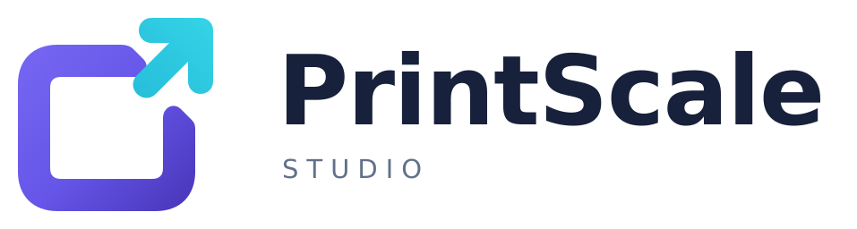
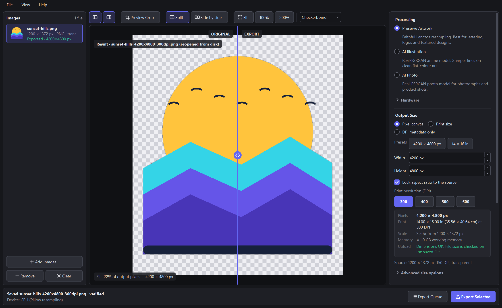

<p align="center">
  <picture>
    <source media="(prefers-color-scheme: dark)" srcset="branding/PrintScaleStudio_Logo_Light.svg">
    
  </picture>
</p>

<p align="center">
  <a href="https://github.com/baki2222/printscale-studio/actions/workflows/ci.yml"></a>
  <a href="https://github.com/baki2222/printscale-studio/releases/latest"></a>
  <a href="LICENSE"></a>
</p>

**PrintScale Studio** is an offline Windows desktop app for enlarging artwork and photos to exact print sizes and
exporting print-ready PNG or JPEG files at 300–600 DPI. It keeps transparency, writes correct resolution metadata,
and checks every file after saving it. Images never leave your computer.



## Download

| | |
|---|---|
| **Installer (recommended)** | [PrintScaleStudio_Setup_v1.0.6.exe](https://github.com/baki2222/printscale-studio/releases/download/v1.0.6/PrintScaleStudio_Setup_v1.0.6.exe): installs for the current user; no administrator rights needed |
| **Portable** | [PrintScaleStudio_v1.0.6_Windows_x64_Portable.zip](https://github.com/baki2222/printscale-studio/releases/download/v1.0.6/PrintScaleStudio_v1.0.6_Windows_x64_Portable.zip): unzip anywhere and run `PrintScaleStudio\PrintScaleStudio.exe` |
| **Checksums** | [SHA256SUMS.txt](https://github.com/baki2222/printscale-studio/releases/download/v1.0.6/SHA256SUMS.txt) |

All releases: [github.com/baki2222/printscale-studio/releases](https://github.com/baki2222/printscale-studio/releases)

- **Requirements:** Windows 11 x64 and about 400 MB of free disk space. Windows 10 x64 is expected to work but has not been tested.
- **GPU:** the AI modes use any DirectX 12 GPU through DirectML. Without one they run on the CPU, which is slower but gives the same kind of result. Preserve Artwork always runs on the CPU.
- **Unsigned builds:** the files are not code-signed, so Windows SmartScreen may show "Windows protected your PC". Check the SHA-256 against `SHA256SUMS.txt` (`Get-FileHash .\PrintScaleStudio_Setup_v1.0.6.exe`), then choose **More info › Run anyway**.

## First use

1. Start **PrintScale Studio** from the Start menu (or `PrintScaleStudio.exe` in the portable folder).
2. **Add Images…**, or drop PNG, JPEG, WebP or TIFF files onto the Images panel.
3. Pick a **processing mode**. **Preserve Artwork** is the safe default for logos, lettering and print designs.
4. Under **Output Size**, choose a pixel canvas (for example the **4200 × 4800 px** preset) or a print size (for example **14 × 16 in**), then a DPI (300, 400, 500 or 600).
5. Use **Preview Crop** to see a real processed region at 100%, then **Export Selected** (one image) or **Export Queue** (all images).
6. The summary shows what was written, read back from the saved file: pixels, DPI, print size, format, alpha and file size.

## Features

- **Three processing modes:**
  - **Preserve Artwork:** Lanczos-3 resampling. Never invents detail and keeps lettering exactly as drawn.
  - **AI Illustration** and **AI Photo:** [Real-ESRGAN](https://github.com/xinntao/Real-ESRGAN) ×4 models, run with ONNX Runtime on DirectML or the CPU.
- **Exact sizing:**
  - **Pixel canvas:** fixed pixels; DPI sets the print size.
  - **Print size:** inches or cm; DPI sets the pixels.
  - **DPI metadata only:** changes only the stored resolution and never touches pixels or image data.
  - **Composition:** fit with padding, or crop to fill. The aspect ratio is never distorted.
- **Transparency:**
  - PNG keeps the alpha channel. Alpha is resampled separately and never passed through the AI models, and hidden colour under transparent pixels can't bleed into edges.
  - JPEG flattens onto a background colour you choose (white by default).
- **Colour:** output is sRGB with an embedded sRGB ICC profile. Inputs with an embedded RGB or CMYK profile are converted through it.
- **Correct metadata:**
  - PNG gets one `pHYs` chunk.
  - JPEG gets matching JFIF density and EXIF X/Y resolution, with any conflict between them resolved.
- **Safe export:**
  - Each file is written to a temporary file, reopened and verified, and only then moved into place.
  - Existing files are never overwritten; a numbered name such as `_1` is used instead.
  - Cancelled jobs leave nothing behind.
- **Batch:** export a whole queue with the same settings, cancel at any time, and get a per-file summary.
- **Comparison viewer:** split or side-by-side view, Fit / 100% / 200% of real output pixels, and checkerboard, white, black or grey backgrounds.
- **Dark and light themes:** the window size, panels and your last settings are remembered.

### About DPI

DPI is print-size information, not image detail. Adding DPI metadata alone adds no pixels. What matters is the
pixel count for the print size you need:

| Print size | 300 DPI | 400 DPI | 500 DPI | 600 DPI |
|---|---|---|---|---|
| 14 × 16 in | 4200 × 4800 px | 5600 × 6400 px | 7000 × 8000 px | 8400 × 9600 px |

The reverse also holds: 4200 × 4800 px at 500 DPI is 8.4 × 9.6 in. AI enlargement can sharpen soft edges, but it
can also change lettering and textures or exaggerate fringes that were already in the source, so always inspect
the result. Preserve Artwork remains the conservative choice. The built-in **upload profile** check (PNG/JPEG,
at most 52,428,800 bytes and 23,000 px per side) reports whether a saved file fits those limits. It is a
convenience check, not a guarantee of any print-on-demand platform's rules.

More detail: [docs/USAGE.md](docs/USAGE.md) · [docs/TROUBLESHOOTING.md](docs/TROUBLESHOOTING.md)

## Run from source

```powershell
git clone https://github.com/baki2222/printscale-studio.git
cd printscale-studio
py -3.11 -m venv .venv
.\.venv\Scripts\Activate.ps1
python -m pip install -r requirements-dev.txt -c constraints.txt
python scripts/fetch_models.py      # downloads and SHA-256-verifies the two ONNX models (~85 MB)
python main.py
python -m pytest                    # test suite (headless Qt)
```

Building the installer and portable ZIP: [docs/BUILDING.md](docs/BUILDING.md). Models and their provenance:
[docs/MODELS.md](docs/MODELS.md).

## Contributing and support

Bug reports, focused fixes and documentation improvements are welcome. See [CONTRIBUTING.md](CONTRIBUTING.md).
Please report security problems privately as described in [SECURITY.md](SECURITY.md). Everyone taking part
follows the [Code of Conduct](CODE_OF_CONDUCT.md).

## License

PrintScale Studio is released under the [MIT License](LICENSE), © 2026 Baki Billah. The release packages include
third-party components under their own licenses, including Qt/PySide6 (LGPL-3.0), ONNX Runtime (MIT), DirectML
(Microsoft license terms), NumPy, Pillow and the Real-ESRGAN model weights (BSD-3-Clause). See
[THIRD_PARTY_LICENSES.md](THIRD_PARTY_LICENSES.md) for details and how to get the corresponding Qt source code.
